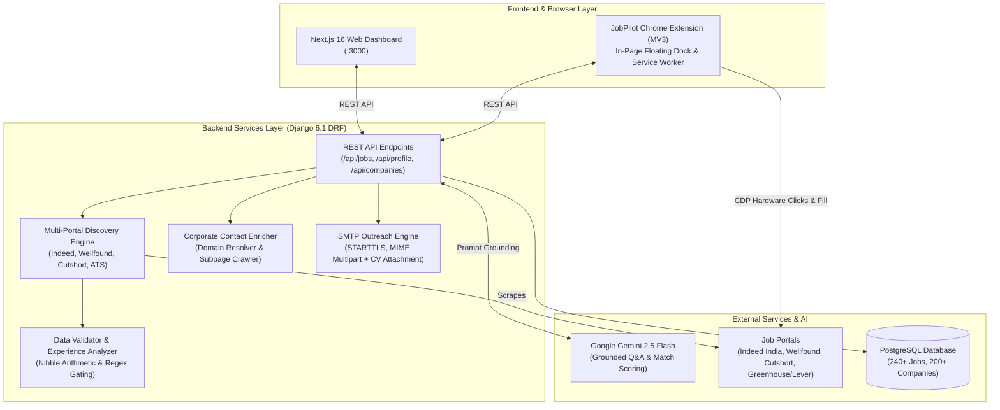

# 🚀 JobPilot — Autonomous Career Intelligence & 1-Click Application Ecosystem

[](https://www.python.org/)
[](https://www.djangoproject.com/)
[](https://nextjs.org/)
[](https://react.dev/)
[](https://www.typescriptlang.org/)
[](https://www.postgresql.org/)
[](https://tailwindcss.com/)
[](https://developer.chrome.com/docs/extensions/)
[-brightgreen.svg?style=for-the-badge)]()

> **JobPilot** is a production-grade full-stack career platform and browser automation ecosystem. It aggregates tech opportunities across multiple job boards, eliminates ghost and mismatched roles via algorithmic filters, scores candidate fit with Gemini AI, and executes unblockable 1-click applications via a Cloudflare-immune Chrome Extension companion.

---

## 📌 Problem Statement

The modern technical hiring landscape is fragmented and heavily congested:
1. **Application Fatigue & Ghost Jobs:** Candidates spend 4–6 minutes per application manually re-typing identical details and screening answers across fragmented portals, only to get rejected by blunt ATS filters or apply to stale ghost postings.
2. **Anti-Bot WAF Firewalls:** Enterprise job platforms (especially Indeed, Wellfound) deploy aggressive bot detection (Cloudflare Turnstile, WAF, JA3/JA4 TLS fingerprinting). Server-side headless automation tools (Playwright, Selenium) get blocked before the application form even loads.

---

## 💡 The JobPilot Architectural Solution

JobPilot decouples high-volume server-side data ingestion from client-side application execution:
- **Server-Side Engine (Django REST + PostgreSQL):** Handles multi-portal web scraping, data normalization, heuristic experience parsing, contact enrichment, and Gemini 2.5 Flash prompt orchestration.
- **Client-Side Companion (Chrome Extension Manifest V3):** Executes directly inside the user's authentic residential Chrome session using existing login cookies, bypassing Cloudflare challenges completely.
- **Hardware-Level Automation (CDP):** Leverages the **Chrome DevTools Protocol (`chrome.debugger`)** to dispatch trusted mouse events (`isTrusted: true`) and intercept the native OS file picker (`Page.fileChooserOpened`) to automatically attach candidate PDF resumes without manual intervention.

---

## 🏗️ System Architecture



---

## ⚡ Key Features

### 1. 🔍 Multi-Portal Query Fan-Out Discovery
- Concurrently queries and aggregates listings from **Indeed India**, **Wellfound (AngelList)**, **Cutshort**, and **Direct ATS Boards (Greenhouse, Lever)**.
- Parses embedded `application/ld+json` schemas for verified timestamps and salary structures.
- Deduplicates listings across portals and binds results to session-scoped `DiscoveryRun` instances.

### 2. 🛡️ Algorithmic Data Hygiene & Anti-Fake Job Engine
- **Patterned Hex Detection:** Arithmetic nibble analysis (`is_patterned_hex_id`) detects and purges sequential/descending placeholder Indeed job keys (e.g., `0f1e2d3c4b5a6978`).
- **Experience Requirement Analyzer:** Analyzes numerical year requirements (`3-5 years`, `min 2 yrs`) and Indian tech salary heuristics ($\ge$ 15 LPA) to automatically reclassify senior roles away from fresher dashboard views.
- **Dead Page Signature Detection:** Automatically flags expired postings and suppresses invalid company names.

### 3. 🧩 Cloudflare-Immune Chrome Extension Copilot (MV3)
- **Authentic Residential Execution:** Runs within the candidate's active browser, leveraging real residential IP, authenticated session cookies, and authentic GPU rendering contexts.
- **CDP Hardware Injection:** Emulates native mouse clicks (`Input.dispatchMouseEvent` with `isTrusted: true`) to bypass bot detection.
- **OS File Chooser Suppression:** Listens to `Page.fileChooserOpened` via CDP, silently binding the local resume PDF via `DOM.setFileInputFiles` without freezing on OS dialog popups.
- **SPA React Prototype Value Setter:** Overrides standard DOM setters using `Object.getOwnPropertyDescriptor(window.HTMLInputElement.prototype, "value")` to trigger React 19 / Angular virtual DOM updates.

### 4. 🧠 Grounding-Augmented AI Screening Assistant (Gemini 2.5 Flash)
- Intercepts dynamic application screening questions ("Why should we hire you?", "Describe your experience with Python", founder notes).
- Grounds prompts in the candidate's verified PDF resume, past projects, and the specific target JD to synthesize articulate first-person responses.
- Dynamically resolves multi-choice radio and dropdown questions using structured JSON schema responses.

### 5. 📬 Recruiter Contact Enrichment & Automated SMTP Outreach
- Scans job descriptions and crawls official company websites (`/contact`, `/about`, `/careers`) to uncover HR emails and verified phone numbers.
- Generates hyper-personalized cold email pitches referencing active company roles using Gemini.
- Asynchronously dispatches outreach emails with the candidate's PDF resume attached via **Gmail SMTP (port 587, STARTTLS)** with network failover and rate pacing.

### 6. ⚡ Sequential Bulk Auto-Pilot
- Multi-select jobs from the dashboard and launch hands-free sequential execution.
- Opens background tabs (`active: false`), enforces a **50-second watchdog timer** per job to prevent modal deadlocks, and features an instant **Emergency Stop** (`⏹️ Stop Auto-Pilot`) in the dock.

---

## 📁 Repository Structure

```
job_portal/
├── backend/                       # Django 6.1 REST Framework API
│   ├── config/                    # Django settings, URLs, WSGI/ASGI
│   ├── jobs/                      # Jobs app: models, views, serializers, tests
│   │   ├── management/commands/   # Custom commands (purge_fake_jobs, setup_browser_session)
│   │   └── services/              # Core business logic:
│   │       ├── discovery_engine.py         # Multi-portal crawler & query fan-out
│   │       ├── job_validator.py            # Patterned hex key & dead page validator
│   │       ├── experience_analyzer.py      # Seniority & numerical year parser
│   │       ├── semantic_domain_matcher.py  # 7-domain ontology taxonomy
│   │       ├── contact_enricher.py         # Corporate contact extraction crawler
│   │       ├── email_outreach_service.py   # Gmail SMTP STARTTLS outreach engine
│   │       ├── eligibility.py              # Application mode & filter eligibility
│   │       └── auto_apply_runner.py        # Playwright stealth runner (fallback)
│   ├── profiles/                  # Candidate profile, verified answers & resumes
│   │   └── services/
│   │       ├── resume_parser.py            # pypdf stream extraction & NLP skills parser
│   │       └── question_answerer.py        # Gemini 2.5 Flash grounded Q&A engine
│   └── requirements.txt           # Python dependencies
├── frontend/                      # Next.js 16 (App Router) + React 19 UI
│   ├── src/
│   │   ├── app/                   # Next.js pages:
│   │   │   ├── page.tsx           # Main analytics dashboard
│   │   │   ├── jobs/page.tsx      # Multi-portal job discovery & bulk auto-apply
│   │   │   ├── companies/page.tsx # Recruiter directory & SMTP outreach CRM
│   │   │   └── profile/page.tsx   # Resume manager & verified answers store
│   │   ├── components/ui/         # shadcn/ui design components
│   │   └── lib/                   # TypeScript API client & utilities
│   └── package.json
├── extension/                     # Chrome Extension (Manifest V3)
│   ├── manifest.json              # Extension manifest declaring CDP debugger permissions
│   ├── popup/                     # Dark mode toolbar popup UI & backend sync
│   └── scripts/
│       ├── background.js          # Service worker, CDP attachment & bulk queue
│       └── content.js             # In-page floating dock & DOM auto-fill engine
├── docs/                          # Architecture decision logs & extension guides
│   ├── DECISIONS.md               # Architectural decision records
│   ├── JOBPILOT_CHROME_EXTENSION_GUIDE.md # Extension setup & CDP guide
│   └── PROJECT_PROGRESS.md        # Feature completion milestone log
├── ai_job_search_automation_plan_v1.1.md # Initial technical project roadmap
├── jobpilot_ecosystem_blueprint.md       # Strategic ecosystem blueprint
└── README.md
```

---

## 🛠️ Technology Stack Summary

| Layer | Technologies |
| :--- | :--- |
| **Backend** | Python 3.12, Django 6.1.2, Django REST Framework 3.18.3, PostgreSQL 18.4, Psycopg2-binary |
| **Frontend** | Next.js 16.4.3 (Turbopack), React 19.3.0, TypeScript 5, Tailwind CSS v4, shadcn/ui, Sonner |
| **Browser Companion** | Chrome Extension Manifest V3, Chrome DevTools Protocol (CDP), Service Workers |
| **AI / LLM** | Google Gemini 2.5 Flash, `google-genai` SDK, Few-Shot CV Grounding |
| **Web Scraping & NLP**| BeautifulSoup4, Requests, Urllib, `pypdf` 6.21.4, Regex Pattern Matchers |
| **Protocols & Mail** | SMTP (STARTTLS, Port 587, MIMEMultipart), HTTP/REST, WebSocket (CDP) |
| **Testing** | Django Test Framework (`TestCase`, `APIClient`) — 17 automated tests |

---

## 🚀 Quick Start Guide

### Prerequisites
- **Python 3.12+**
- **Node.js 20+** & **npm 10+**
- **PostgreSQL 15+**
- **Google Chrome** (for Extension)

---

### 1. Backend Setup

```bash
cd backend

# Create and activate virtual environment
python -m venv venv
# On Windows:
venv\Scripts\activate
# On Linux/macOS:
source venv/bin/activate

# Install dependencies
pip install -r requirements.txt

# Configure Environment Variables
# Create backend/.env:
# SECRET_KEY=your_django_secret_key
# DEBUG=True
# DB_NAME=job_portal
# DB_USER=postgres
# DB_PASSWORD=your_postgres_password
# DB_HOST=localhost
# DB_PORT=5432
# FRONTEND_URL=http://localhost:3000
# GEMINI_API_KEY=your_gemini_api_key
# OUTREACH_EMAIL=your_email@gmail.com
# OUTREACH_PASSWORD=your_google_app_password
# OUTREACH_NAME="Your Name"

# Apply Database Migrations
python manage.py migrate

# Run Backend Unit Tests (17 tests)
python manage.py test jobs.tests --keepdb

# Start Development Server
python manage.py runserver
```
Backend runs at `http://127.0.0.1:8000/`.

---

### 2. Frontend Setup

```bash
cd frontend

# Install npm packages
npm install

# Start Next.js Development Server
npm run dev
```
Dashboard opens at `http://localhost:3000/`.

---

### 3. Chrome Extension Companion Setup

1. Open **Google Chrome** and navigate to `chrome://extensions/`.
2. Enable **Developer mode** (top-right toggle).
3. Click **Load unpacked** (top-left).
4. Select the `extension/` directory from this project:
   ```
   job_portal/extension/
   ```
5. Pin **JobPilot Copilot ⚡** to your Chrome toolbar.
6. Open any job posting on Indeed or startup portals — the floating **JobPilot Copilot** dock will appear in the bottom-right corner!

---

## 🧪 Testing & Verification

The backend includes a comprehensive unit test suite covering validation algorithms, experience parsers, eligibility gates, and bulk queue status transitions:

```bash
cd backend
python manage.py test jobs.tests --keepdb
```

```text
Ran 17 tests in 0.526s
OK
```

---

## 📜 License & Credits

Distributed under the MIT License. Developed with engineering rigor by **[Tushar Gupta](https://github.com/TusharGupta4)**.
